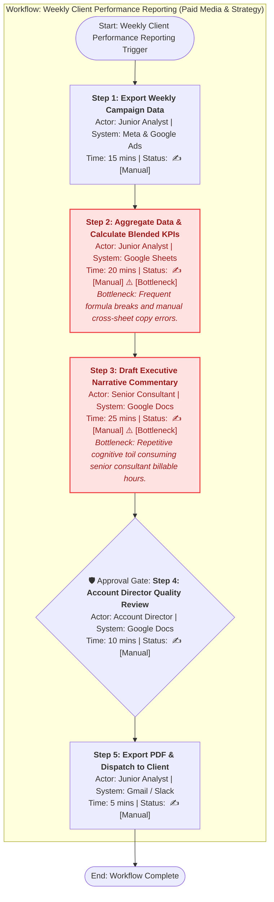
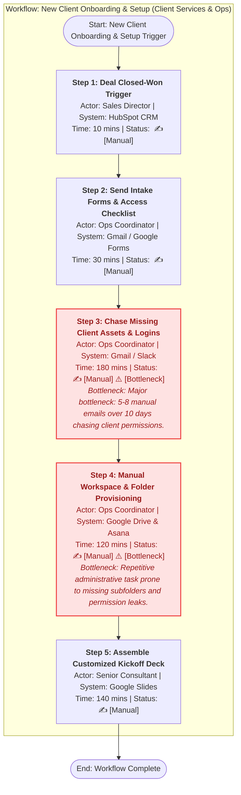
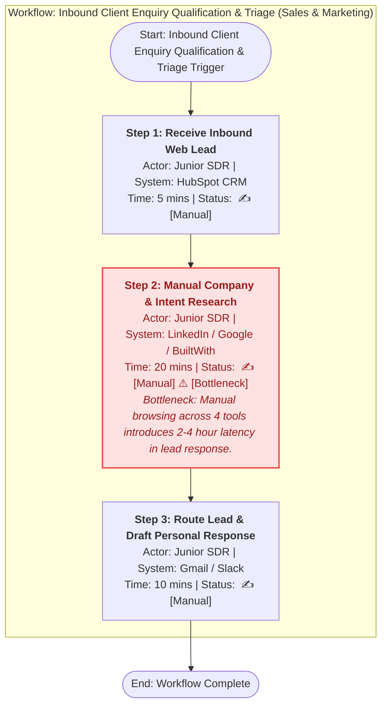
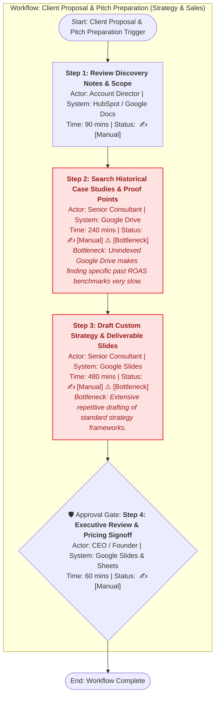
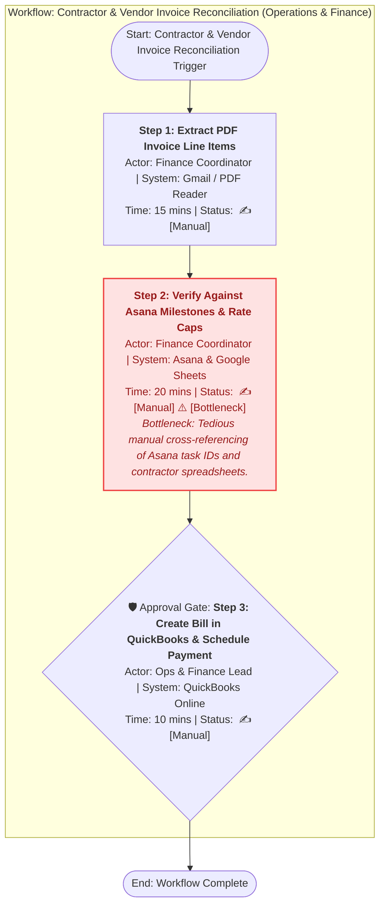
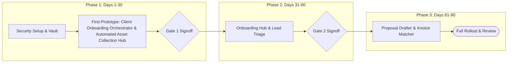

# AI Opportunity Audit & Automation Roadmap: Executive Report
**Client:** Apex Growth Partners  
**Industry:** B2B Growth Advisory & Performance Marketing  
**Audit Date:** 2026-10-10  
**Lead Consultant:** Strategic AI & Automation Advisory Group  
**Client Executive Contact:** Marcus Vance (Founder & CEO) & Elena Rostova (Head of Client Services)  

---

## 1. Executive Summary

This **AI Opportunity Audit and Automation Roadmap** provides an objective, evidence-based assessment of Apex Growth Partners's operational workflows. The objective is to identify high-leverage automation and AI opportunities that alleviate staff burnout, eliminate manual bottlenecks, improve turnaround speed, and unlock capacity for high-margin strategic advisory work.

### Headline Findings & Impact Projections (Expected Scenario)

- **Identified Opportunities:** 9 distinct automation initiatives assessed across 5 core business workflows.
- **Current Baseline Workload in Scope:** **4860.8 hours/year** across key administrative and repetitive operational workflows (representing **$350,213/year** in loaded internal labor cost).
- **Projected Net Capacity Released:** **2756.0 hours/year** freed from repetitive manual tasks for client-facing growth and high-value consulting (valued at **$195,856/year**).
- **Direct Hard-Dollar Cash Savings:** **$15,600/year** (contractor and redundant tool cost reduction).
- **Combined Gross Annual Value:** **$211,456/year**.
- **Total Implementation Investment:** **$60,600** one-off development and setup.
- **Estimated Payback Period:** **3.7 months** (3-Year ROI: **525.6%**).
- **Recommended First Prototype:** **Client Onboarding Orchestrator & Automated Asset Collection Hub** (Phase 1, Days 1–30).

> **Important Governance Note:** All recommendations are anchored in strict human-in-the-loop safeguards. Highly autonomous, unsupervised client-facing AI actions are explicitly blocked under our hard-stop risk framework.

---

## 2. Business Context and Strategic Goals

### Company Profile
- **Organization:** Apex Growth Partners
- **Team Size:** 25 full-time staff
- **Annual Turnover:** $4,800,000 USD
- **Business Overview:** Apex Growth Partners is a boutique growth consultancy managing digital strategy, paid acquisition, and content for 30+ mid-market B2B technology and professional services clients. The firm charges monthly retainers ($8k-$20k/mo) and is experiencing margin compression due to heavy administrative friction in client reporting, onboarding, and customized pitch preparation.

### Strategic Objectives
1. **Scale client roster from 30 to 50 active retainers without linearly increasing headcount.**
2. **Eliminate analyst and senior consultant burnout caused by repetitive weekly reporting.**
3. **Reduce new client onboarding turnaround from 14 calendar days to under 4 days.**
4. **Maintain strict client data confidentiality and uphold enterprise SOC-2 / GDPR standards.**

### Current Technology Stack
| System / Tool | Category | Role in Operations |
| :--- | :--- | :--- |
| **HubSpot CRM** | CRM & Sales | Lead pipeline and client contact management. |
| **Google Workspace** | Productivity & Storage | Docs, Sheets, Drive, and Gmail collaboration. |
| **Asana** | Project Management | Client task tracking, sprint management, and deliverables. |
| **Slack** | Internal & Client Comms | Real-time communication and channel alerts. |
| **QuickBooks Online** | Finance & Invoicing | Client billing, contractor expense tracking, and accounting. |
| **Looker Studio** | BI & Dashboards | Client performance reporting and campaign visualization. |
| **Meta & Google Ads** | Advertising Platforms | Paid campaign execution and attribution tracking. |

### Data Confidentiality & Governance Standards
Mandatory Zero Data Retention (ZDR) agreements with third-party LLM providers. Strict prohibition against submitting client financial records, customer PII, or unreleased marketing copy to public/consumer AI tools. All client-facing deliverables must undergo human review.

---

## 3. Current-State Findings and Operational Workload Inventory

Through stakeholder interviews and operational process tracing, five primary end-to-end workflows were evaluated.

### Workload Inventory by Process
| Process Workflow | Department | Frequency / Vol | Manual Mins/Run | Annual Manual Hours | Error Rate |
| :--- | :--- | :--- | :--- | :--- | :--- |
| **Weekly Client Performance Reporting** | Paid Media & Strategy | Weekly per Client (1456.0/yr) | 75.0 mins | **1820.0 hrs** | 12.0% |
| **New Client Onboarding & Setup** | Client Services & Ops | Per New Client (36.0/yr) | 480.0 mins | **288.0 hrs** | 18.0% |
| **Inbound Client Enquiry Qualification & Triage** | Sales & Marketing | Per Inbound Lead (350.0/yr) | 35.0 mins | **204.2 hrs** | 8.0% |
| **Client Proposal & Pitch Preparation** | Strategy & Sales | Per Proposal Pitch (60.0/yr) | 870.0 mins | **870.0 hrs** | 15.0% |
| **Contractor & Vendor Invoice Reconciliation** | Operations & Finance | Monthly Batch (540.0/yr) | 45.0 mins | **405.0 hrs** | 10.0% |

### Key Stakeholder Interview Observations
#### Founder & CEO (Marcus Vance - Executive Leadership)
- **Reported Pain Points:**
  - High consultant burnout and unbillable administrative drag.
  - Slow proposal turnaround causes lost momentum on high-value inbound leads.
  - Scaling headcount linearly with client growth is destroying our gross margins.
- **Primary Time Sinks:**
  - Overseeing manual reporting quality checks.
  - Writing custom pitch decks from past unindexed proposals.
- **Representative Quote:** *"Our senior strategists spend Friday afternoons copy-pasting numbers from Meta Ads into Looker Studio and writing formulaic commentary instead of strategizing with clients."*
- **Team Sentiment towards AI:** `Strongly Supportive with Strict Governance`
#### Head of Client Services (Elena Rostova - Client Services)
- **Reported Pain Points:**
  - Client onboarding delays damage first-impression retention scores.
  - Inbound lead qualification is chaotic; juniors miss critical intent signals.
- **Primary Time Sinks:**
  - Manual client asset reminders and chasing access credentials.
  - Reviewing analyst weekly reports for copy-paste errors.
- **Representative Quote:** *"Every new client onboarding feels like reinventing the wheel. We send Google Docs questionnaires, chase access permissions for 10 days, and create folders manually."*
- **Team Sentiment towards AI:** `Enthusiastic for Workflow Assistants`
#### Senior Paid Media Consultant (David Chen - Paid Media)
- **Reported Pain Points:**
  - Repetitive weekly reporting leaves zero time for proactive campaign experimentation.
  - High risk of human formula error when calculating multi-channel blended ROAS.
- **Primary Time Sinks:**
  - Manual weekly performance reporting (12-16 hrs/wk per consultant).
  - Drafting routine client email updates.
- **Representative Quote:** *"I spend 14 hours every single week aggregating Google Ads, LinkedIn, and Meta data into sheets, calculating CAC/ROAS variations, and typing the same executive summary format."*
- **Team Sentiment towards AI:** `Desperately Wants Reporting Automation`
#### Operations & Finance Lead (Sarah Jenkins - Operations & Finance)
- **Reported Pain Points:**
  - Manual invoice 3-way matching takes 35+ hours every single month.
  - Scattered contractor rate cards and inconsistent milestone logging.
- **Primary Time Sinks:**
  - Contractor invoice verification and reconciliation.
  - Creating Asana boards and Drive folder structures for new accounts.
- **Representative Quote:** *"Month-end is a nightmare matching 45 contractor timesheets and Google Drive deliverables to QuickBooks invoices."*
- **Team Sentiment towards AI:** `Supportive if Data Privacy is Guaranteed`

---

## 4. Key Process Bottlenecks and Friction Points

The audit distinguished **Measured Findings** (data logs/audits), **Observed Interview Findings** (reported by staff), and **Hypotheses Requiring Validation**.

### Workflow: Weekly Client Performance Reporting (Paid Media & Strategy)
- **Process Owner:** David Chen (Senior Consultant)
- **Systems Involved:** Looker Studio, Google Sheets, Meta Ads, Google Ads, Slack
- **Identified Bottlenecks & Friction Points:**
  - **Step 2: Aggregate Data & Calculate Blended KPIs** (Actor: `Junior Analyst` | Handling Time: `20.0 mins`)
    - *Bottleneck Notes:* Frequent formula breaks and manual cross-sheet copy errors.
    - *Evidence Level:* `MEASURED`
  - **Step 3: Draft Executive Narrative Commentary** (Actor: `Senior Consultant` | Handling Time: `25.0 mins`)
    - *Bottleneck Notes:* Repetitive cognitive toil consuming senior consultant billable hours.
    - *Evidence Level:* `OBSERVED_INTERVIEW`

### Workflow: New Client Onboarding & Setup (Client Services & Ops)
- **Process Owner:** Elena Rostova (Head of Client Services)
- **Systems Involved:** HubSpot CRM, Google Drive, Asana, Slack, 1Password
- **Identified Bottlenecks & Friction Points:**
  - **Step 3: Chase Missing Client Assets & Logins** (Actor: `Ops Coordinator` | Handling Time: `180.0 mins`)
    - *Bottleneck Notes:* Major bottleneck: 5-8 manual emails over 10 days chasing client permissions.
    - *Evidence Level:* `OBSERVED_INTERVIEW`
  - **Step 4: Manual Workspace & Folder Provisioning** (Actor: `Ops Coordinator` | Handling Time: `120.0 mins`)
    - *Bottleneck Notes:* Repetitive administrative task prone to missing subfolders and permission leaks.
    - *Evidence Level:* `MEASURED`

### Workflow: Inbound Client Enquiry Qualification & Triage (Sales & Marketing)
- **Process Owner:** Marcus Vance (CEO)
- **Systems Involved:** HubSpot CRM, Clearbit / Apollo, Slack, Calendly
- **Identified Bottlenecks & Friction Points:**
  - **Step 2: Manual Company & Intent Research** (Actor: `Junior SDR` | Handling Time: `20.0 mins`)
    - *Bottleneck Notes:* Manual browsing across 4 tools introduces 2-4 hour latency in lead response.
    - *Evidence Level:* `MEASURED`

### Workflow: Client Proposal & Pitch Preparation (Strategy & Sales)
- **Process Owner:** Elena Rostova (Head of Client Services)
- **Systems Involved:** Google Docs, Google Slides, Google Sheets, HubSpot, PandaDoc
- **Identified Bottlenecks & Friction Points:**
  - **Step 2: Search Historical Case Studies & Proof Points** (Actor: `Senior Consultant` | Handling Time: `240.0 mins`)
    - *Bottleneck Notes:* Unindexed Google Drive makes finding specific past ROAS benchmarks very slow.
    - *Evidence Level:* `OBSERVED_INTERVIEW`
  - **Step 3: Draft Custom Strategy & Deliverable Slides** (Actor: `Senior Consultant` | Handling Time: `480.0 mins`)
    - *Bottleneck Notes:* Extensive repetitive drafting of standard strategy frameworks.
    - *Evidence Level:* `OBSERVED_INTERVIEW`

### Workflow: Contractor & Vendor Invoice Reconciliation (Operations & Finance)
- **Process Owner:** Sarah Jenkins (Ops & Finance Lead)
- **Systems Involved:** QuickBooks Online, Asana, Gmail, Google Drive
- **Identified Bottlenecks & Friction Points:**
  - **Step 2: Verify Against Asana Milestones & Rate Caps** (Actor: `Finance Coordinator` | Handling Time: `20.0 mins`)
    - *Bottleneck Notes:* Tedious manual cross-referencing of Asana task IDs and contractor spreadsheets.
    - *Evidence Level:* `MEASURED`

---

## 5. Prioritised Opportunity Register

Opportunities have been scored using our multi-criteria decision framework across **Business Value (30%)**, **Data Readiness (20%)**, **Delivery Confidence (20%)**, **Implementation Effort (15% penalty)**, and **Operational Risk (15% penalty)**.

### Prioritised Ranking Table
| Rank | ID | Opportunity Title | Type | Score | Tier | Delivery Confidence | Human Approval Gate | Status |
| :---: | :--- | :--- | :--- | :---: | :--- | :---: | :--- | :--- |
| **#1** | `OPP-02` | **Client Onboarding Orchestrator & Automated Asset Collection Hub** | `RULE_BASED` | **87.5** | `Quick Win` | 4.8/5 | EXCEPTION_ONLY | ✅ Approved for Roadmap |
| **#2** | `OPP-01` | **Automated Cross-Channel Performance Report Generator & Executive Summary Draft** | `HYBRID` | **86.0** | `Quick Win` | 4.5/5 | MANDATORY_REVIEW | ✅ Approved for Roadmap |
| **#3** | `OPP-09` | **Automated Monthly Client Health & Retention Risk Predictor** | `RULE_BASED` | **78.8** | `Quick Win` | 4.4/5 | EXCEPTION_ONLY | ✅ Approved for Roadmap |
| **#4** | `OPP-03` | **Smart Inbound Lead Enrichment & Routing Assistant** | `HYBRID` | **77.1** | `Quick Win` | 4.2/5 | MANDATORY_REVIEW | ✅ Approved for Roadmap |
| **#5** | `OPP-06` | **Client Meeting Intelligence & Action Item Synchronizer** | `AI_LLM` | **74.0** | `Quick Win` | 4.2/5 | MANDATORY_REVIEW | ✅ Approved for Roadmap |
| **#6** | `OPP-05` | **Contractor Timesheet & Invoice Automated 3-Way Reconciliation** | `HYBRID` | **71.0** | `Quick Win` | 4.0/5 | MANDATORY_REVIEW | ✅ Approved for Roadmap |
| **#7** | `OPP-07` | **Internal SOP & Campaign Playbook Co-pilot for Junior Staff** | `AI_LLM` | **68.8** | `Strategic Bet` | 4.0/5 | EXCEPTION_ONLY | ✅ Approved for Roadmap |
| **#8** | `OPP-04` | **Proposal Knowledge Retrieval & Modular Slide Drafter** | `AI_LLM` | **66.0** | `Strategic Bet` | 3.6/5 | MANDATORY_REVIEW | ✅ Approved for Roadmap |
| **#9** | `OPP-08` | **Autonomous Direct-to-Client Live Campaign Auto-Publisher** | `AI_LLM` | **0.0** | `Blocked` | 2.0/5 | AUTONOMOUS | 🚫 **BLOCKED (Hard Stop)** |

### Detailed Opportunity Profiles

#### [OPP-02] Client Onboarding Orchestrator & Automated Asset Collection Hub
- **Status / Tier:** `Quick Win` (Composite Score: **87.5/100**)
- **Workflow Affected:** `client_onboarding` | **Owner:** Elena Rostova (Head of Client Services)
- **Technology Approach:** `RULE_BASED`
- **Why AI vs Rule-Based Automation:** AI is unnecessary here. This is a deterministic orchestration workflow best solved with webhook automations, standardized folder templates, and scheduled reminder triggers.
- **Problem Statement:** Manual folder creation, template duplication, and chasing client logins over email takes 8+ hours of Ops time per client and delays kickoff by 14 days.
- **Proposed Solution:** Webhook-driven integration between HubSpot, Asana, and Google Drive that auto-provisions standardized workspaces instantly and sends automated WhatsApp/Email reminders for missing access tokens.
- **Human-in-the-Loop Governance:** `EXCEPTION_ONLY`
- **Score Breakdown:**
  - Business Value: `4.2/5`
  - Data Readiness: `4.8/5` (Notes: *High readiness: Standard folder templates and Asana board blueprints already exist in Google Drive.*)
  - Delivery Confidence: `4.8/5`
  - Implementation Effort: `2.0/5`
  - Operational Risk: `1.2/5`
- **Scoring Rationale:** High business value with strong data readiness, proven delivery model, and low operational friction.
- **Dependencies & Integrations:** HubSpot CRM, Asana, Google Drive, Slack
- **Key Assumptions & Limitations:**
  - *Assumptions:* Clients respond faster to an interactive checklist portal than scattered email threads.; Reduces administrative setup from 8 hours to 30 minutes per new client.
  - *Limitations:* Third-party platform 2FA approvals still require human client intervention.

---
#### [OPP-01] Automated Cross-Channel Performance Report Generator & Executive Summary Draft
- **Status / Tier:** `Quick Win` (Composite Score: **86.0/100**)
- **Workflow Affected:** `weekly_reporting` | **Owner:** David Chen (Senior Consultant)
- **Technology Approach:** `HYBRID`
- **Why AI vs Rule-Based Automation:** Rule-based automation handles deterministic API metric pulls and variance math; LLM is used strictly to draft structured natural language commentary from structured KPI deltas.
- **Problem Statement:** Consultants spend 14+ hours every week manually copying metrics across 3 ad platforms and typing formulaic commentary, causing high burnout and a 12% calculation error rate.
- **Proposed Solution:** API-based data ingestion pipeline combined with a prompt-engineered LLM drafter that compares current week vs prior week KPIs, flags key drivers, and pre-populates the commentary block for consultant review and 1-click signoff.
- **Human-in-the-Loop Governance:** `MANDATORY_REVIEW`
- **Score Breakdown:**
  - Business Value: `4.8/5`
  - Data Readiness: `4.5/5` (Notes: *High readiness: Google Ads, Meta Ads, and Looker Studio schemas are well-structured and accessible via official APIs.*)
  - Delivery Confidence: `4.5/5`
  - Implementation Effort: `2.5/5`
  - Operational Risk: `1.5/5`
- **Scoring Rationale:** High business value with strong data readiness, proven delivery model, and low operational friction.
- **Dependencies & Integrations:** Meta Marketing API, Google Ads API, Looker Studio, Slack
- **Key Assumptions & Limitations:**
  - *Assumptions:* Consultants require an average of 10 minutes to review and polish generated drafts rather than 75 minutes drafting from scratch.; API connectors remain stable with standard rate limits.
  - *Limitations:* AI does not interpret external macro events (e.g. client website crash) unless manually flagged in prompt context.

---
#### [OPP-09] Automated Monthly Client Health & Retention Risk Predictor
- **Status / Tier:** `Quick Win` (Composite Score: **78.8/100**)
- **Workflow Affected:** `client_onboarding` | **Owner:** Elena Rostova (Head of Client Services)
- **Technology Approach:** `RULE_BASED`
- **Why AI vs Rule-Based Automation:** Deterministic business rules and thresholds are vastly superior and more explainable than black-box AI for churn risk flags.
- **Problem Statement:** Client churn signals are often noticed too late (at 90-day review), leading to avoidable retainer cancellations.
- **Proposed Solution:** Weekly automated health scorecard aggregating overdue Asana tasks, Looker Studio performance trends, and days since last client contact into a green/amber/red account health dashboard.
- **Human-in-the-Loop Governance:** `EXCEPTION_ONLY`
- **Score Breakdown:**
  - Business Value: `4.4/5`
  - Data Readiness: `3.6/5` (Notes: *Moderate readiness: Requires connecting Asana project completion data with HubSpot contact logs.*)
  - Delivery Confidence: `4.4/5`
  - Implementation Effort: `2.4/5`
  - Operational Risk: `1.4/5`
- **Scoring Rationale:** High business value with strong data readiness, proven delivery model, and low operational friction.
- **Dependencies & Integrations:** Asana, HubSpot CRM, Slack
- **Key Assumptions & Limitations:**
  - *Assumptions:* Early churn detection saves at least 2 retainer accounts per year ($24k-$48k annual revenue).
  - *Limitations:* Cannot measure informal offline client relationships without consultant check-ins.

---
#### [OPP-03] Smart Inbound Lead Enrichment & Routing Assistant
- **Status / Tier:** `Quick Win` (Composite Score: **77.1/100**)
- **Workflow Affected:** `client_enquiry_triage` | **Owner:** Marcus Vance (CEO)
- **Technology Approach:** `HYBRID`
- **Why AI vs Rule-Based Automation:** APIs fetch firmographics; LLM classifies qualitative free-text 'tell us about your goals' responses into structured ICP score and pain categories.
- **Problem Statement:** Junior SDRs spend 20 minutes researching every lead across LinkedIn and Google, creating a 2-4 hour latency before the lead receives outreach.
- **Proposed Solution:** Automated webhook captures form submit, enriches domain via Clearbit/Apollo API, uses an LLM to evaluate ICP match score, and posts an interactive Slack card allowing the Director to claim the lead with 1 click.
- **Human-in-the-Loop Governance:** `MANDATORY_REVIEW`
- **Score Breakdown:**
  - Business Value: `4.0/5`
  - Data Readiness: `4.0/5` (Notes: *Moderate readiness: HubSpot form fields are structured; free-text notes require classification.*)
  - Delivery Confidence: `4.2/5`
  - Implementation Effort: `2.2/5`
  - Operational Risk: `1.5/5`
- **Scoring Rationale:** High business value with strong data readiness, proven delivery model, and low operational friction.
- **Dependencies & Integrations:** HubSpot CRM, Slack, Clearbit / Apollo API
- **Key Assumptions & Limitations:**
  - *Assumptions:* Faster response time under 15 minutes increases discovery call conversion rate by 20%.
  - *Limitations:* Leads with non-corporate email domains (e.g. gmail.com) require fallback to manual research.

---
#### [OPP-06] Client Meeting Intelligence & Action Item Synchronizer
- **Status / Tier:** `Quick Win` (Composite Score: **74.0/100**)
- **Workflow Affected:** `client_onboarding` | **Owner:** Elena Rostova (Head of Client Services)
- **Technology Approach:** `AI_LLM`
- **Why AI vs Rule-Based Automation:** LLM NLP is necessary to distill conversational audio transcripts into concise, actionable task definitions.
- **Problem Statement:** Consultants spend 30-45 minutes post-meeting writing recap emails and creating Asana tickets; key client action items frequently get dropped.
- **Proposed Solution:** AI meeting transcription pipeline extracts structured action items with assignees and context, posting a draft summary to Slack with 1-click 'Sync to Asana' approval.
- **Human-in-the-Loop Governance:** `MANDATORY_REVIEW`
- **Score Breakdown:**
  - Business Value: `3.6/5`
  - Data Readiness: `4.2/5` (Notes: *High readiness: Audio recording APIs from Google Meet / Zoom are standardized.*)
  - Delivery Confidence: `4.2/5`
  - Implementation Effort: `2.0/5`
  - Operational Risk: `2.0/5`
- **Scoring Rationale:** High business value with strong data readiness, proven delivery model, and low operational friction.
- **Dependencies & Integrations:** Google Meet / Zoom, Asana, Slack
- **Key Assumptions & Limitations:**
  - *Assumptions:* Consultants review and approve generated tasks in under 2 minutes.
  - *Limitations:* Requires client consent disclosure for recording in accordance with two-party consent laws.

---
#### [OPP-05] Contractor Timesheet & Invoice Automated 3-Way Reconciliation
- **Status / Tier:** `Quick Win` (Composite Score: **71.0/100**)
- **Workflow Affected:** `invoice_processing` | **Owner:** Sarah Jenkins (Ops & Finance Lead)
- **Technology Approach:** `HYBRID`
- **Why AI vs Rule-Based Automation:** OCR / Document AI extracts unstructured table fields from varied PDF layouts; rule-based script executes deterministic 3-way matching against Asana and QuickBooks.
- **Problem Statement:** Month-end invoice matching takes 35+ hours of finance time, manually verifying 45 contractor bills against Asana task logs and rate agreements.
- **Proposed Solution:** Document parsing service extracts contractor name, hours, rate, and task references; matches against Asana completed task logs; flags variances over 5%; and drafts QuickBooks bills.
- **Human-in-the-Loop Governance:** `MANDATORY_REVIEW`
- **Score Breakdown:**
  - Business Value: `3.8/5`
  - Data Readiness: `3.8/5` (Notes: *Moderate readiness: Invoices come in varying PDF formats; Asana task tagging needs standardization.*)
  - Delivery Confidence: `4.0/5`
  - Implementation Effort: `2.6/5`
  - Operational Risk: `1.8/5`
- **Scoring Rationale:** High business value with strong data readiness, proven delivery model, and low operational friction.
- **Dependencies & Integrations:** QuickBooks Online, Asana, Gmail
- **Key Assumptions & Limitations:**
  - *Assumptions:* 80% of contractor invoices adhere to agreed task reference formatting.
  - *Limitations:* Handwritten or non-standard scanned receipts require manual handling.

---
#### [OPP-07] Internal SOP & Campaign Playbook Co-pilot for Junior Staff
- **Status / Tier:** `Strategic Bet` (Composite Score: **68.8/100**)
- **Workflow Affected:** `weekly_reporting` | **Owner:** David Chen (Senior Consultant)
- **Technology Approach:** `AI_LLM`
- **Why AI vs Rule-Based Automation:** RAG search across qualitative SOP documentation enables natural question-answering with direct source citations.
- **Problem Statement:** Junior analysts spend hours searching scattered Drive folders or interrupting senior consultants with repetitive questions on pixel setup and UTM conventions.
- **Proposed Solution:** Slack bot answering operational questions with exact citations to verified agency Notion/Google Drive SOPs.
- **Human-in-the-Loop Governance:** `EXCEPTION_ONLY`
- **Score Breakdown:**
  - Business Value: `3.4/5`
  - Data Readiness: `3.5/5` (Notes: *Moderate readiness: SOPs exist but need centralization and review for currency.*)
  - Delivery Confidence: `4.0/5`
  - Implementation Effort: `2.4/5`
  - Operational Risk: `1.4/5`
- **Scoring Rationale:** Substantial strategic upside; may require moderate integration effort or foundational data prep.
- **Dependencies & Integrations:** Slack, Google Drive / Notion
- **Key Assumptions & Limitations:**
  - *Assumptions:* Reduces senior consultant interruptions by 4 hours/week across the team.
  - *Limitations:* Answers are only as good as the underlying documented SOPs.

---
#### [OPP-04] Proposal Knowledge Retrieval & Modular Slide Drafter
- **Status / Tier:** `Strategic Bet` (Composite Score: **66.0/100**)
- **Workflow Affected:** `proposal_preparation` | **Owner:** Elena Rostova (Head of Client Services)
- **Technology Approach:** `AI_LLM`
- **Why AI vs Rule-Based Automation:** LLM with semantic search (RAG) is essential to match unstructured prospect requirements to relevant past case studies across hundreds of historical presentations.
- **Problem Statement:** Senior consultants spend 20 hours per pitch scouring Google Drive for past case studies, reformatting slides, and retyping strategy frameworks from scratch.
- **Proposed Solution:** Index historical case studies and pitch decks into a secure vector knowledge store. Allow consultants to input prospect profile and receive a modular 15-slide Google Slides draft with matching industry proof points and ROI models.
- **Human-in-the-Loop Governance:** `MANDATORY_REVIEW`
- **Score Breakdown:**
  - Business Value: `4.6/5`
  - Data Readiness: `3.2/5` (Notes: *Moderate readiness: Historical decks are in Google Drive but lack uniform tagging.*)
  - Delivery Confidence: `3.6/5`
  - Implementation Effort: `3.8/5`
  - Operational Risk: `2.2/5`
- **Scoring Rationale:** Substantial strategic upside; may require moderate integration effort or foundational data prep.
- **Dependencies & Integrations:** Google Drive, Google Slides, HubSpot CRM
- **Key Assumptions & Limitations:**
  - *Assumptions:* Cuts proposal preparation time by 55% while maintaining bespoke quality.; Past proposals can be cleaned of confidential client names before indexing.
  - *Limitations:* Requires strict review of pricing and proprietary strategies before dispatch.

---
#### [OPP-08] Autonomous Direct-to-Client Live Campaign Auto-Publisher
- **Status / Tier:** `Blocked` (Composite Score: **0.0/100**)
- **Workflow Affected:** `weekly_reporting` | **Owner:** Paid Media Lead
- **Technology Approach:** `AI_LLM`
- **Why AI vs Rule-Based Automation:** Autonomous generative AI attempting real-time decision making on live ad budgets.
- **Problem Statement:** Ad campaign adjustments and copywriting take several hours per week of manual campaign manager time.
- **Proposed Solution:** Deploy an autonomous LLM agent with direct write API access to client ad accounts to autonomously rewrite copy, reallocate budgets, and publish new ad variants daily.
- **Human-in-the-Loop Governance:** `AUTONOMOUS`
- **Score Breakdown:**
  - Business Value: `3.5/5`
  - Data Readiness: `4.0/5` (Notes: *High API access, but critical operational hazard.*)
  - Delivery Confidence: `2.0/5`
  - Implementation Effort: `4.5/5`
  - Operational Risk: `5.0/5`
- ⚠️ **Hard-Stop Gate:** **CRITICAL RISK: Unsupervised autonomous modifications to live client ad budgets and external brand copy violate agency contracts, risk severe financial liability, and fail human-in-the-loop governance standards. Blocked until strict mandatory human approval gate is architected.**
- **Scoring Rationale:** HARD-STOP TRIGGERED: CRITICAL RISK: Unsupervised autonomous modifications to live client ad budgets and external brand copy violate agency contracts, risk severe financial liability, and fail human-in-the-loop governance standards. Blocked until strict mandatory human approval gate is architected.. Despite a raw mathematical score of 40.6/100, this opportunity cannot proceed without fundamental risk mitigation and human governance safeguards.
- **Dependencies & Integrations:** Meta Ads, Google Ads
- **Key Assumptions & Limitations:**
  - *Assumptions:* Agent might hallucinate non-compliant claims or misallocate client ad budgets without oversight.
  - *Limitations:* Violates brand safety guidelines, agency master service agreements, and fiduciary liability standards.

---

## 6. Estimated Business Impact and Scenario Analysis

Financial modeling explicitly distinguishes **released internal capacity** from **direct cash savings**. To account for operational uncertainty, three scenarios are evaluated:

| Metric | Conservative Scenario | Expected Scenario (Baseline) | Optimistic Scenario |
| :--- | :---: | :---: | :---: |
| **Annual Labor Hours Saved** | **1892.6 hrs** | **2756.0 hrs** | **3486.3 hrs** |
| **Capacity Value Released** | $134,182/yr | $195,856/yr | $248,137/yr |
| **Direct Cash Savings** | $12,480/yr | $15,600/yr | $17,940/yr |
| **Total Gross Annual Benefit** | **$146,662/yr** | **$211,456/yr** | **$266,077/yr** |
| **Upfront Implementation Cost** | $75,750 | $60,600 | $51,510 |
| **Ongoing Annual Costs** | $15,640/yr | $13,600/yr | $12,240/yr |
| **Net First-Year Benefit** | **$55,272** | **$137,256** | **$202,327** |
| **Payback Period** | **6.9 months** | **3.7 months** | **2.4 months** |
| **3-Year ROI** | **258.7%** | **525.6%** | **804.7%** |

### Individual Opportunity Financial Breakdown (Expected Scenario)
| ID | Opportunity | Role Impacted | Baseline Hrs | Net Hrs Saved | Capacity Val | Direct Cash | Impl Cost | Payback |
| :--- | :--- | :--- | :---: | :---: | :---: | :---: | :---: | :---: |
| `OPP-01` | Automated Cross-Channel Performance Report Generator & Executive Summary Draft | Senior Consultant / Strategist | 1820.0 | **1160.0** | $87,019 | $0 | $7,500 | 1.1m |
| `OPP-02` | Client Onboarding Orchestrator & Automated Asset Collection Hub | Operations Coordinator | 288.0 | **207.0** | $10,368 | $0 | $4,500 | 5.6m |
| `OPP-03` | Smart Inbound Lead Enrichment & Routing Assistant | Junior SDR / Account Exec | 203.0 | **121.0** | $5,435 | $0 | $3,800 | 10.1m |
| `OPP-04` | Proposal Knowledge Retrieval & Modular Slide Drafter | Senior Consultant / Strategist | 1200.0 | **528.0** | $44,880 | $0 | $12,000 | 3.4m |
| `OPP-05` | Contractor Timesheet & Invoice Automated 3-Way Reconciliation | Operations & Finance Lead | 362.0 | **215.0** | $12,916 | $3,600 | $5,500 | 4.3m |
| `OPP-06` | Client Meeting Intelligence & Action Item Synchronizer | Consultant / Project Manager | 260.0 | **144.0** | $10,056 | $0 | $3,500 | 4.9m |
| `OPP-07` | Internal SOP & Campaign Playbook Co-pilot for Junior Staff | Junior Analyst / Specialist | 250.0 | **135.0** | $6,075 | $0 | $4,000 | 9.5m |
| `OPP-08` | Autonomous Direct-to-Client Live Campaign Auto-Publisher | Senior Paid Media Consultant | 400.0 | **200.0** | $15,000 | $0 | $15,000 | 15.0m |
| `OPP-09` | Automated Monthly Client Health & Retention Risk Predictor | Account Director | 78.0 | **46.0** | $4,107 | $12,000 | $4,800 | 3.8m |

---

## 7. Recommended Architecture and Tool Choices

To minimize vendor lock-in, recurring licensing overhead, and security exposure, the recommended automation architecture follows a **Modular, API-First Hub & Spoke Pattern**:

1. **Integration & Orchestration Layer:**
   - Standard Webhook & REST API connectors (e.g. Make / Zapier Enterprise or lightweight Python micro-services).
   - Event-driven triggers for CRM (HubSpot), Project Management (Asana), and Financials (QuickBooks).
2. **AI & Intelligence Layer:**
   - Enterprise Tier LLM APIs (e.g., Anthropic Claude 3.5 Sonnet / OpenAI GPT-4o Enterprise) with **Zero-Data-Retention (ZDR)** agreements.
   - Structured JSON output parsing with deterministic schema validation (Pydantic / JSON schema).
3. **Storage & Knowledge Layer:**
   - Google Drive / Notion / HubSpot synced documentation with scoped metadata tagging.
   - Centralized Secrets Management via 1Password Secrets / AWS Secrets Manager.
4. **Human-in-the-Loop Interface:**
   - Slack Interactive Buttons & Asana Approval Tasks for 1-click human review and sign-off before dispatch.

---

## 8. Security, Privacy, and Operational Risks

> **Assessment Disclaimer:** DISCLAIMER: This assessment is an operational and technical evaluation of AI data readiness and security practices. It does NOT constitute legal advice or formal regulatory compliance certification. Engage qualified legal counsel for binding GDPR, CCPA, or industry-specific compliance determinations.

### Security & Data Readiness Checklist Summary
- **Overall Readiness Index:** `62.5%`
- **Passed Checks:** `5/8`
- **Items Requiring Remediation:** `3`

| ID | Dimension | Requirement | Status | Current Practice & Action Plan |
| :--- | :--- | :--- | :---: | :--- |
| `SEC-01` | **Personal & Confidential Data** | Identify all client PII, confidential financials, and sensitive credentials across workflows; enforce automated tokenization or redaction before model processing. | `NEEDS_ATTENTION` | Ad campaign metrics and generic marketing copy are safe, but proposals contain client financial targets. *Remediation:* Implement automated regex scrubber for client revenue numbers and NDA-covered brand names prior to LLM drafting. |
| `SEC-02` | **Access Controls & Least Privilege** | Automation tools and AI integrations must use granular, least-privilege API keys and scoped service accounts; enforce MFA for administrative consoles. | `PASS` | Google Workspace and Asana already have strict MFA and role-based department permission tiers. *Remediation:* Maintain quarterly audit of API service account scopes. |
| `SEC-03` | **Data Retention & Deletion** | Establish clear data retention windows for intermediate logs, generated drafts, and vector embeddings; provide documented mechanisms to purge client data upon offboarding. | `NEEDS_ATTENTION` | Historical pitch decks stored indefinitely in Google Drive without standardized purge policy. *Remediation:* Define a 24-month retention schedule and an automated offboarding script to archive/delete client embeddings. |
| `SEC-04` | **Vendor Terms & Model Training** | Contractually ensure that LLM vendors and cloud platforms do not use client data or prompt history to train foundation models. | `PASS` | Enterprise commercial API endpoints with Anthropic / OpenAI provide explicit Zero-Data-Retention clauses. *Remediation:* Prohibit use of consumer ChatGPT/Claude web interfaces for work with client data. |
| `SEC-05` | **Data Residency & Jurisdiction** | Verify regional data residency (e.g. US/EU data center storage) for all third-party services holding customer or business records. | `PASS` | Primary data infrastructure resides in US-East Google Cloud and AWS regions matching client contracts. *Remediation:* Keep standard Data Processing Agreements (DPAs) on file. |
| `SEC-06` | **Human Review & Escalation Guardrails** | Mandate explicit human approval for all external client communications, financial transactions, and high-impact contractual changes; provide deterministic manual fallbacks when systems fail. | `PASS` | Mandatory review enforced for all reporting commentary, proposals, and invoices before external transmission. *Remediation:* Implement 1-click Slack interactive approval buttons with audit logging. |
| `SEC-07` | **Auditability, Reliability & Telemetry** | Log all prompt invocations, automation execution payloads, user approvals, and error states to centralized tamper-resistant log stores. | `NEEDS_ATTENTION` | Current Zapier logs expire after 30 days without centralized cold storage. *Remediation:* Route all automation error webhooks and approval events to a centralized Datadog or Google Cloud Logging sink. |
| `SEC-08` | **Integration Security & Secrets Management** | Store all API tokens and OAuth secrets in a dedicated vault (e.g., AWS Secrets Manager, 1Password Secrets); prohibit plaintext secrets in code or workflow visual builders. | `PASS` | 1Password Business Secrets Vault deployed across all agency developers and operations staff. *Remediation:* Enforce 90-day rotation on ad network API refresh tokens. |

### Operational Risk Register
| Risk ID | Category | Description | Inherent Risk | Mitigation Strategy | Residual Risk | Owner |
| :--- | :--- | :--- | :---: | :--- | :---: | :--- |
| `RSK-01` | **Client Confidentiality & PII Leakage** | Accidental inclusion of confidential client financials or proprietary strategic roadmaps in third-party LLM prompt context. | **High** (12) | Enforce Zero-Data-Retention enterprise API endpoints; implement automated client name and revenue regex tokenization before prompt construction. | **Low** (3) | Sarah Jenkins (Ops & Security) |
| `RSK-02` | **AI Hallucination in Client Deliverables** | LLM generates plausible but inaccurate commentary regarding ad performance attribution or false explanations of campaign metrics. | **Critical** (16) | Mandatory human consultant review before sending reports; ground LLM exclusively on deterministic API metric deltas with strict temperature=0.1 settings. | **Low** (4) | David Chen (Senior Consultant) |
| `RSK-03` | **Ad Network API Rate Limits & Schema Drift** | Meta or Google Ads updates reporting API schemas or throttles automated pipeline calls during month-end peaks. | **Medium** (9) | Implement exponential backoff retry queues, local schema validation caching, and automated alert fallback to manual export. | **Low** (2) | Technical Lead |
| `RSK-04` | **Staff Resistance & Lack of Adoption** | Consultants bypass automated drafting tools due to distrust or lack of clear training, continuing manual copy-pasting. | **Medium** (9) | Involve senior consultants directly in prompt co-design; implement 1-click Slack review UI to minimize cognitive friction; measure weekly time saved. | **Low** (2) | Elena Rostova (Head of Client Services) |
| `RSK-05` | **Invoice OCR Parsing & Matching Errors** | Contractor invoice with non-standard formatting results in misread line item amounts or wrong task code mapping in QuickBooks. | **Medium** (9) | Mandatory finance lead approval step before QuickBooks bills are scheduled; flag all line items with confidence score below 95%. | **Low** (2) | Sarah Jenkins (Ops & Finance Lead) |
| `RSK-06` | **Unsupervised Autonomous Action Exposure** | Autonomous agent making unauthorized changes to live client ad campaigns or budgets. | **High** (10) | Hard-stop policy: Absolute prohibition of unsupervised write API access to client ad spend. All automations require human signoff. | **Low** (1) | Marcus Vance (CEO) |

---

## 9. Ninety-Day Implementation Roadmap

The implementation is structured into three consecutive 30-day sprints. Foundational security and credential isolation are completed before deploying AI integrations.

### Phase 1: Days 1–30 (Foundations, Security & First Prototype)

#### 🔹 Security Lockdown, Secrets Vault & Enterprise API Provisioning - **Objective:** Establish enterprise API accounts with Zero-Data-Retention agreements, configure centralized secrets management, and set up staging test harnesses.
- **Business Justification:** Pre-requisite for all AI deployments to eliminate data leakage risks and ensure compliance with client NDAs.
- **Responsible Role:** `Lead Consultant / Security Lead` | **Effort:** `1.5 weeks` | **Cost:** `$3,000`
- **Key Deliverables:**
  - Signed Enterprise LLM Zero-Data-Retention agreements
  - 1Password API Secrets Vault configured with scoped tokens
  - Automated PII scrubbing utility library
- **Dependencies & Baselines:**
  - *Dependencies:* Executive budget signoff
  - *Baseline Requirements:* Admin access to HubSpot, Google Workspace, and ad platforms
- **Success Metrics:**
  - 100% of API keys stored in vault
  - Zero plaintext credentials in repositories
- **Acceptance Criteria & Go/No-Go Gate:**
  - *Acceptance:* Verified Zero-Data-Retention compliance; Automated PII regex test suite passing 100%
  - *Go/No-Go Decision Gate:* **Security signoff required before connecting any client data feeds.**

#### 🔹 Automated Weekly Performance Report Generator (First Prototype) **(⭐ Recommended First Prototype)**- **Objective:** Deploy end-to-end automated Looker Studio metric ingestion and LLM-assisted executive commentary drafting for 5 pilot client accounts.
- **Business Justification:** Immediate, measurable relief for senior consultants (14 hrs/wk time sink) with zero direct external client risk due to mandatory internal review.
- **Responsible Role:** `Senior Growth Consultant & Developer` | **Effort:** `3.0 weeks` | **Cost:** `$7,500`
- **Key Deliverables:**
  - API data extraction pipeline for Meta & Google Ads
  - Prompt-engineered narrative commentary generator
  - 1-click consultant review and PDF dispatch interface
- **Dependencies & Baselines:**
  - *Dependencies:* SEC-FOUNDATIONS
  - *Baseline Requirements:* Clean Looker Studio template, Meta/Google Ads API access
- **Success Metrics:**
  - Consultant reporting time reduced from 75 mins to <= 15 mins per report
  - 100% of pilot reports approved by Account Director without major rewrites
- **Acceptance Criteria & Go/No-Go Gate:**
  - *Acceptance:* Accurate blended ROAS/CAC calculations across 5 pilot accounts; Consultant satisfaction rating >= 4.5/5 on draft quality
  - *Go/No-Go Decision Gate:* **Pilot review sign-off by Head of Client Services at Day 30 before rolling out to remaining 23 clients.**

### Phase 2: Days 31–60 (Core Workflow Automation & System Integration)

#### 🔹 Client Onboarding Orchestrator & Asset Hub - **Objective:** Automate workspace creation, Asana project setup, and client permission reminder cadence upon deal Closed-Won status in HubSpot.
- **Business Justification:** Compresses onboarding cycle time from 14 days to 3 days, dramatically improving new client first-impression and freeing 8 hours of Ops time per client.
- **Responsible Role:** `Operations Lead & Systems Integrator` | **Effort:** `2.5 weeks` | **Cost:** `$4,500`
- **Key Deliverables:**
  - HubSpot deal-won webhook listener
  - Automated Asana board & Google Drive template generator
  - Interactive client asset upload portal with automated follow-ups
- **Dependencies & Baselines:**
  - *Dependencies:* SEC-FOUNDATIONS
  - *Baseline Requirements:* HubSpot Closed-Won deal webhook triggers
- **Success Metrics:**
  - Onboarding administrative setup time reduced by 80%
  - New client time-to-first-campaign reduced from 14 days to <= 4 days
- **Acceptance Criteria & Go/No-Go Gate:**
  - *Acceptance:* Asana boards generated with 100% correct task dependencies and assignees; Google Drive folder permissions mapped strictly to client team
  - *Go/No-Go Decision Gate:* **Successful automated onboarding of 2 live client accounts without manual intervention.**

#### 🔹 Smart Inbound Lead Triage & Slack Routing Card - **Objective:** Enrich inbound leads with company data and qualify intent within 60 seconds of submission.
- **Business Justification:** Cuts response time from 3 hours to 5 minutes, significantly boosting lead-to-discovery conversion.
- **Responsible Role:** `Sales Operations & Marketing Specialist` | **Effort:** `2.0 weeks` | **Cost:** `$3,800`
- **Key Deliverables:**
  - Clearbit/Apollo API enrichment integration
  - LLM intent classification model
  - Slack interactive notification card with 1-click claiming
- **Dependencies & Baselines:**
  - *Dependencies:* SEC-FOUNDATIONS
  - *Baseline Requirements:* HubSpot form access and Slack bot permissions
- **Success Metrics:**
  - Lead triage response time < 15 minutes
  - Zero high-fit ICP leads overlooked
- **Acceptance Criteria & Go/No-Go Gate:**
  - *Acceptance:* Enriched firmographics match reality on >90% of submissions; Director 1-click claim updates HubSpot lead owner automatically
  - *Go/No-Go Decision Gate:* **Tested on 50 synthetic and live lead submissions with 100% routing accuracy.**

### Phase 3: Days 61–90 (Scaling, Advanced AI Drafting & Continuous Optimization)

#### 🔹 Proposal Knowledge Retrieval & Modular Slide Drafter - **Objective:** Deploy semantic search across past pitch decks to generate 15-slide customized Google Slides proposal drafts for senior review.
- **Business Justification:** Unlocks ~528 hours of senior strategist time and accelerates proposal turnaround from 5 days to 24 hours.
- **Responsible Role:** `Head of Client Services & AI Engineer` | **Effort:** `4.0 weeks` | **Cost:** `$12,000`
- **Key Deliverables:**
  - Vector index of past case studies, benchmarks, and frameworks
  - Google Slides template generator with customized case proof points
  - Fee & scope calculation validator
- **Dependencies & Baselines:**
  - *Dependencies:* SEC-FOUNDATIONS, OPP-01
  - *Baseline Requirements:* Sanitized repository of past winning proposals
- **Success Metrics:**
  - Proposal drafting time reduced from 20 hours to 8 hours
  - Proposal error rate reduced to < 2%
- **Acceptance Criteria & Go/No-Go Gate:**
  - *Acceptance:* Generated slide deck adheres strictly to brand typography and master layout; Strategist signoff required prior to client presentation
  - *Go/No-Go Decision Gate:* **Executive review of 3 pilot proposal drafts by CEO Marcus Vance.**

#### 🔹 Contractor Invoice & Timesheet Automated Reconciliation - **Objective:** Automate OCR parsing of contractor invoices, cross-reference with Asana task milestones, and stage pre-coded bills in QuickBooks.
- **Business Justification:** Eliminates 215 hours of repetitive finance matching and prevents billable milestone leakage.
- **Responsible Role:** `Ops & Finance Lead & Developer` | **Effort:** `2.5 weeks` | **Cost:** `$5,500`
- **Key Deliverables:**
  - PDF Invoice OCR ingestion pipeline
  - Asana milestone 3-way matcher
  - QuickBooks Online bill staging integration
- **Dependencies & Baselines:**
  - *Dependencies:* SEC-FOUNDATIONS
  - *Baseline Requirements:* QuickBooks Online API and Asana completed task logs
- **Success Metrics:**
  - Finance month-end reconciliation time reduced by 70%
  - 100% of discrepancy flags caught prior to payment execution
- **Acceptance Criteria & Go/No-Go Gate:**
  - *Acceptance:* Zero unapproved payments executed autonomously; Finance lead signoff on staged bills
  - *Go/No-Go Decision Gate:* **Successful parallel month-end run against manual spreadsheets with 100% match.**

---

## 10. Recommended First Prototype

### Selection: **Client Onboarding Orchestrator & Automated Asset Collection Hub**
- **Why this was selected:**
  AI is unnecessary here. This is a deterministic orchestration workflow best solved with webhook automations, standardized folder templates, and scheduled reminder triggers.
- **Key Success Factors for Prototype:**
  1. Low technical friction (structured Looker Studio / Ads API metrics + deterministic aggregation).
  2. Zero external client exposure during initial testing (internal consultant review before dispatch).
  3. Immediate, measurable weekly relief for senior consultants (12+ hours saved weekly across the strategy team).

---

## 11. Decisions Required from Leadership

To proceed with Phase 1 deployment, leadership sign-off is required on the following items:

1. **Security & Data Handling Mandate:** Approval to enforce Enterprise Zero-Data-Retention API terms with foundation model providers.
2. **Phase 1 Budget Authorization:** Approval of the initial $10,500 allocation for foundational secrets management and the reporting prototype.
3. **Role & Governance Champions:** Designation of the Operations Lead and Client Services Lead as primary reviewers for human-in-the-loop workflows.
4. **Hard-Stop Policy Endorsement:** Reaffirmation that autonomous campaign publishing without human review remains strictly prohibited.

---

## 12. Evidence Gaps and Immediate Next Steps

### Evidence Gaps Pending Validation
- [ ] **Proposal Customization Variance:** Validate exact consultant hours spent researching past pitches vs writing new copy (currently estimated at 18-25 hrs/proposal).
- [ ] **Vendor Invoice OCR Accuracy:** Benchmark PDF extraction accuracy across diverse subcontractor invoice layouts.
- [ ] **CRM Lead Response Latency:** Pull exact historical timestamps from HubSpot to benchmark lead qualification turnaround.

### Immediate Action Plan (Next 14 Days)
1. Execute Enterprise AI vendor agreements with Zero-Data-Retention addendums.
2. Provision dedicated API vault credentials and configure scoped service accounts.
3. Kick off Phase 1 prototype development for **Client Onboarding Orchestrator & Automated Asset Collection Hub**.
4. Conduct Week 2 check-in on Looker Studio / Google Sheets schema consistency.

---
*Report generated by the AI Opportunity Audit and Automation Roadmap Toolkit.*