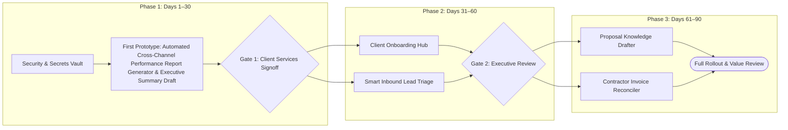

# 90-Day AI & Automation Implementation Roadmap
**Client:** Apex Growth Partners | **Audit Date:** 2026-10-10  
**Lead Consultant:** Strategic AI & Automation Advisory Group | **Sponsor:** Marcus Vance (Founder & CEO) & Elena Rostova (Head of Client Services)

---

## Roadmap Architecture & Governance Principles
1. **Foundations First:** Complete Zero-Data-Retention agreements, access credential vaulting, and automated PII scrubbers before connecting live client data feeds.
2. **Internal Prototype Validation:** The initial 30-day prototype (**Automated Cross-Channel Performance Report Generator & Executive Summary Draft**) is evaluated internally by consultants with 100% human sign-off before client exposure.
3. **Stage Gates:** Every 30 days features a formal executive Go / No-Go review before proceeding to subsequent workflow integrations.

---

## Phase 1: Days 1–30 (Foundations, Security & First Prototype)

### 🎯 Security Lockdown, Secrets Vault & Enterprise API Provisioning - **Objective:** Establish enterprise API accounts with Zero-Data-Retention agreements, configure centralized secrets management, and set up staging test harnesses.
- **Business Justification:** Pre-requisite for all AI deployments to eliminate data leakage risks and ensure compliance with client NDAs.
- **Responsible Owner:** `Lead Consultant / Security Lead`
- **Estimated Effort:** `1.5 weeks` | **Estimated Investment:** `$3,000`
- **Key Deliverables:**
  - [ ] Signed Enterprise LLM Zero-Data-Retention agreements
  - [ ] 1Password API Secrets Vault configured with scoped tokens
  - [ ] Automated PII scrubbing utility library
- **Technical Dependencies & Baselines:**
  - *Dependencies:* Executive budget signoff
  - *Baseline Requirements:* Admin access to HubSpot, Google Workspace, and ad platforms
- **Measurable Success Metrics:**
  - 📈 100% of API keys stored in vault
  - 📈 Zero plaintext credentials in repositories
- **Acceptance Criteria & Decision Gate:**
  - *Acceptance:* Verified Zero-Data-Retention compliance; Automated PII regex test suite passing 100%
  - *Go/No-Go Gate:* **Security signoff required before connecting any client data feeds.**

---
### 🎯 Automated Weekly Performance Report Generator (First Prototype) **(⭐ Recommended First Prototype)**- **Objective:** Deploy end-to-end automated Looker Studio metric ingestion and LLM-assisted executive commentary drafting for 5 pilot client accounts.
- **Business Justification:** Immediate, measurable relief for senior consultants (14 hrs/wk time sink) with zero direct external client risk due to mandatory internal review.
- **Responsible Owner:** `Senior Growth Consultant & Developer`
- **Estimated Effort:** `3.0 weeks` | **Estimated Investment:** `$7,500`
- **Key Deliverables:**
  - [ ] API data extraction pipeline for Meta & Google Ads
  - [ ] Prompt-engineered narrative commentary generator
  - [ ] 1-click consultant review and PDF dispatch interface
- **Technical Dependencies & Baselines:**
  - *Dependencies:* SEC-FOUNDATIONS
  - *Baseline Requirements:* Clean Looker Studio template, Meta/Google Ads API access
- **Measurable Success Metrics:**
  - 📈 Consultant reporting time reduced from 75 mins to <= 15 mins per report
  - 📈 100% of pilot reports approved by Account Director without major rewrites
- **Acceptance Criteria & Decision Gate:**
  - *Acceptance:* Accurate blended ROAS/CAC calculations across 5 pilot accounts; Consultant satisfaction rating >= 4.5/5 on draft quality
  - *Go/No-Go Gate:* **Pilot review sign-off by Head of Client Services at Day 30 before rolling out to remaining 23 clients.**

---
## Phase 2: Days 31–60 (Core Workflow Automation & System Integration)

### 🎯 Client Onboarding Orchestrator & Asset Hub - **Objective:** Automate workspace creation, Asana project setup, and client permission reminder cadence upon deal Closed-Won status in HubSpot.
- **Business Justification:** Compresses onboarding cycle time from 14 days to 3 days, dramatically improving new client first-impression and freeing 8 hours of Ops time per client.
- **Responsible Owner:** `Operations Lead & Systems Integrator`
- **Estimated Effort:** `2.5 weeks` | **Estimated Investment:** `$4,500`
- **Key Deliverables:**
  - [ ] HubSpot deal-won webhook listener
  - [ ] Automated Asana board & Google Drive template generator
  - [ ] Interactive client asset upload portal with automated follow-ups
- **Technical Dependencies & Baselines:**
  - *Dependencies:* SEC-FOUNDATIONS
  - *Baseline Requirements:* HubSpot Closed-Won deal webhook triggers
- **Measurable Success Metrics:**
  - 📈 Onboarding administrative setup time reduced by 80%
  - 📈 New client time-to-first-campaign reduced from 14 days to <= 4 days
- **Acceptance Criteria & Decision Gate:**
  - *Acceptance:* Asana boards generated with 100% correct task dependencies and assignees; Google Drive folder permissions mapped strictly to client team
  - *Go/No-Go Gate:* **Successful automated onboarding of 2 live client accounts without manual intervention.**

---
### 🎯 Smart Inbound Lead Triage & Slack Routing Card - **Objective:** Enrich inbound leads with company data and qualify intent within 60 seconds of submission.
- **Business Justification:** Cuts response time from 3 hours to 5 minutes, significantly boosting lead-to-discovery conversion.
- **Responsible Owner:** `Sales Operations & Marketing Specialist`
- **Estimated Effort:** `2.0 weeks` | **Estimated Investment:** `$3,800`
- **Key Deliverables:**
  - [ ] Clearbit/Apollo API enrichment integration
  - [ ] LLM intent classification model
  - [ ] Slack interactive notification card with 1-click claiming
- **Technical Dependencies & Baselines:**
  - *Dependencies:* SEC-FOUNDATIONS
  - *Baseline Requirements:* HubSpot form access and Slack bot permissions
- **Measurable Success Metrics:**
  - 📈 Lead triage response time < 15 minutes
  - 📈 Zero high-fit ICP leads overlooked
- **Acceptance Criteria & Decision Gate:**
  - *Acceptance:* Enriched firmographics match reality on >90% of submissions; Director 1-click claim updates HubSpot lead owner automatically
  - *Go/No-Go Gate:* **Tested on 50 synthetic and live lead submissions with 100% routing accuracy.**

---
## Phase 3: Days 61–90 (Scaling, Advanced AI Drafting & Continuous Optimization)

### 🎯 Proposal Knowledge Retrieval & Modular Slide Drafter - **Objective:** Deploy semantic search across past pitch decks to generate 15-slide customized Google Slides proposal drafts for senior review.
- **Business Justification:** Unlocks ~528 hours of senior strategist time and accelerates proposal turnaround from 5 days to 24 hours.
- **Responsible Owner:** `Head of Client Services & AI Engineer`
- **Estimated Effort:** `4.0 weeks` | **Estimated Investment:** `$12,000`
- **Key Deliverables:**
  - [ ] Vector index of past case studies, benchmarks, and frameworks
  - [ ] Google Slides template generator with customized case proof points
  - [ ] Fee & scope calculation validator
- **Technical Dependencies & Baselines:**
  - *Dependencies:* SEC-FOUNDATIONS, OPP-01
  - *Baseline Requirements:* Sanitized repository of past winning proposals
- **Measurable Success Metrics:**
  - 📈 Proposal drafting time reduced from 20 hours to 8 hours
  - 📈 Proposal error rate reduced to < 2%
- **Acceptance Criteria & Decision Gate:**
  - *Acceptance:* Generated slide deck adheres strictly to brand typography and master layout; Strategist signoff required prior to client presentation
  - *Go/No-Go Gate:* **Executive review of 3 pilot proposal drafts by CEO Marcus Vance.**

---
### 🎯 Contractor Invoice & Timesheet Automated Reconciliation - **Objective:** Automate OCR parsing of contractor invoices, cross-reference with Asana task milestones, and stage pre-coded bills in QuickBooks.
- **Business Justification:** Eliminates 215 hours of repetitive finance matching and prevents billable milestone leakage.
- **Responsible Owner:** `Ops & Finance Lead & Developer`
- **Estimated Effort:** `2.5 weeks` | **Estimated Investment:** `$5,500`
- **Key Deliverables:**
  - [ ] PDF Invoice OCR ingestion pipeline
  - [ ] Asana milestone 3-way matcher
  - [ ] QuickBooks Online bill staging integration
- **Technical Dependencies & Baselines:**
  - *Dependencies:* SEC-FOUNDATIONS
  - *Baseline Requirements:* QuickBooks Online API and Asana completed task logs
- **Measurable Success Metrics:**
  - 📈 Finance month-end reconciliation time reduced by 70%
  - 📈 100% of discrepancy flags caught prior to payment execution
- **Acceptance Criteria & Decision Gate:**
  - *Acceptance:* Zero unapproved payments executed autonomously; Finance lead signoff on staged bills
  - *Go/No-Go Gate:* **Successful parallel month-end run against manual spreadsheets with 100% match.**

---

## Prototype Selection Rationale: Automated Cross-Channel Performance Report Generator & Executive Summary Draft
Rule-based automation handles deterministic API metric pulls and variance math; LLM is used strictly to draft structured natural language commentary from structured KPI deltas.